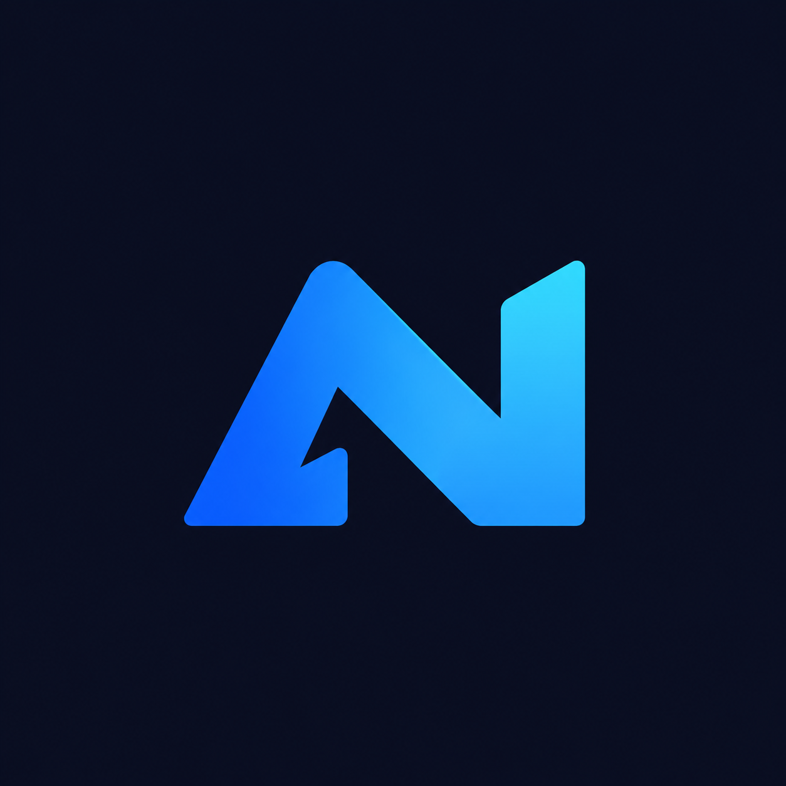
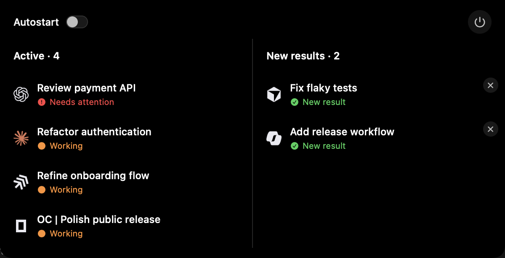

<p align="center">
  
</p>

<h1 align="center">AgentNotch</h1>

<p align="center">
  See what your coding agents are doing — right at the notch.
</p>

<p align="center">
  
</p>

## Download

[Download AgentNotch](https://github.com/BenMoeckel/agentnotch/releases/latest/download/AgentNotch-macos.dmg) for macOS 14+ (Apple silicon and Intel).

Open the DMG, drag **AgentNotch.app** into **Applications**, and launch it.

The build is ad-hoc signed, not notarized, so macOS may block the first launch. Open **System Settings → Privacy & Security**, click **Open Anyway**, and confirm. If macOS reports the app as damaged:

```sh
xattr -dr com.apple.quarantine /Applications/AgentNotch.app
```

## Use

Hover the notch for one second to expand it. Click a session to jump to its terminal or editor window; the power button quits AgentNotch. The chart button next to the power button opens usage statistics with agent limits, time per project, daily activity (including a streak), and a trend chart. It works with Claude Code, Codex, OpenCode, Gemini, Cursor, GitHub Copilot and other coding agents.

The Agents card shows the latest locally reported Codex 5-hour and weekly quota consumption, reset times and observation timestamp, refreshed every minute while the dashboard is open. Expired windows await a new provider report; agents without local quota data show “Limit data unavailable”. Limits are independent of the selected statistics period.

The statistics panel extends down the screen and scrolls through all recorded agents and projects. It includes total working time, active days and average time per active day. Choose 30 days, 90 days, 1 year or All time from the period dropdown. The green activity heatmap shows the selected calendar year, with month and weekday labels and a year selector on the right. Hover heatmap days and trend bars for detailed values with haptic feedback. The heatmap legend uses fixed thresholds: 0m, under 15m, 15–60m, 1–4h and 4h or more. Available local Claude Code, Codex and OpenCode logs are imported in the background for completed days, including history older than a year. Historical times are estimates; overlapping sessions count only once toward total working time. Other agents are recorded live while AgentNotch runs.

For exact VS Code window navigation, install the optional `AgentNotch-bridge.vsix` from the same release.

## Build

Requires macOS 14+, Xcode 16+, and Node.js 18+.

```sh
git clone https://github.com/BenMoeckel/agentnotch.git
cd agentnotch
xcodebuild -project AgentNotch.xcodeproj -scheme AgentNotch \
  -configuration Debug -derivedDataPath build CODE_SIGNING_ALLOWED=NO build
npm test
```

## License

[MIT](LICENSE) · [Third-party notices](THIRD_PARTY_NOTICES.md)
