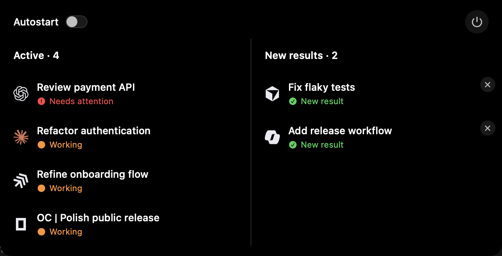

<p align="center">
  
</p>

<h1 align="center">AgentNotch</h1>

<p align="center">
  See what your coding agents are doing — right at the notch.
</p>

<p align="center">
  
</p>

## Download

[Download AgentNotch](https://github.com/BenMoeckel/agentnotch/releases/latest/download/AgentNotch-macos.dmg) for macOS 14+ (Apple silicon and Intel).

Open the DMG, drag **AgentNotch.app** into **Applications**, and launch it.

The build is ad-hoc signed, not notarized, so macOS may block the first launch. Open **System Settings → Privacy & Security**, click **Open Anyway**, and confirm. If macOS reports the app as damaged:

```sh
xattr -dr com.apple.quarantine /Applications/AgentNotch.app
```

## Use

Hover the notch for one second to expand it. Click a session to jump to its terminal or editor window; the power button quits AgentNotch. It works with Claude Code, Codex, OpenCode, Gemini, Cursor, GitHub Copilot and other coding agents.

For exact VS Code window navigation, install the optional `AgentNotch-bridge.vsix` from the same release.

## Build

Requires macOS 14+, Xcode 16+, and Node.js 18+.

```sh
git clone https://github.com/BenMoeckel/agentnotch.git
cd agentnotch
xcodebuild -project AgentNotch.xcodeproj -scheme AgentNotch \
  -configuration Debug -derivedDataPath build CODE_SIGNING_ALLOWED=NO build
npm test
```

## License

[MIT](LICENSE) · [Third-party notices](THIRD_PARTY_NOTICES.md)
