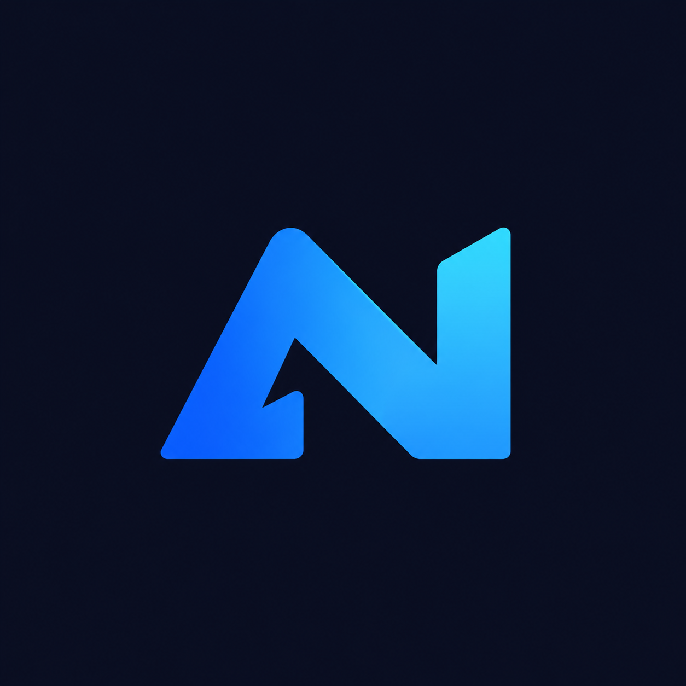

<p align="center">
  
</p>

<h1 align="center">AgentNotch</h1>

<p align="center">
  A native macOS notch overlay for coding agents. See what is working, what needs attention and what just finished — then jump straight back to the exact terminal, pane or editor window.
</p>

<p align="center">
  <a href="https://github.com/BenMoeckel/agentnotch/releases/latest"></a>
  <a href="LICENSE"></a>
  
  
</p>

AgentNotch stays anchored to the built-in camera notch even when another monitor is primary or focused. Display changes, wake and Space switches refresh its placement automatically. With the lid closed, it falls back to the top center of the primary external display.

It discovers known agent executables and npm entry points across the current user's processes, including agents launched from terminals and VS Code extensions. Herdr is optional. There are no model API calls, no account and no telemetry.

## Download and install

**[Download the latest release](https://github.com/BenMoeckel/agentnotch/releases/latest)**

| File | Use |
| --- | --- |
| [`AgentNotch-macos.dmg`](https://github.com/BenMoeckel/agentnotch/releases/latest/download/AgentNotch-macos.dmg) | Recommended. Open, drag AgentNotch into Applications. |
| [`AgentNotch-macos.zip`](https://github.com/BenMoeckel/agentnotch/releases/latest/download/AgentNotch-macos.zip) | Portable archive. Unzip and move `AgentNotch.app` to Applications. |
| [`AgentNotch-bridge.vsix`](https://github.com/BenMoeckel/agentnotch/releases/latest/download/AgentNotch-bridge.vsix) | Optional VS Code Session Bridge for exact editor-window navigation. |
| [`SHA256SUMS.txt`](https://github.com/BenMoeckel/agentnotch/releases/latest/download/SHA256SUMS.txt) | Checksums for the downloaded files. |

The build is a universal binary for **Apple silicon and Intel Macs** and requires **macOS 14 Sonoma or newer**.

### First launch

AgentNotch is currently **ad-hoc signed, not notarized**, because notarization requires a paid Apple Developer Program account. Releases are built from this repository by the [release workflow](.github/workflows/release.yml), but macOS will still show a warning the first time.

1. Open the DMG and drag **AgentNotch.app** into **Applications**.
2. Double-click AgentNotch. If macOS blocks it, open **System Settings → Privacy & Security**, scroll to **Security**, click **Open Anyway**, authenticate, then confirm **Open**.
3. On macOS 14 you can also right-click the app and choose **Open**.
4. If macOS reports the app as “damaged” instead, remove the download quarantine once:
   ```sh
   xattr -dr com.apple.quarantine /Applications/AgentNotch.app
   open /Applications/AgentNotch.app
   ```
5. When prompted, allow AgentNotch to control the terminal you want to navigate. Automation permission is requested only after you click a session. Accessibility is optional and used only for editors without the VS Code bridge.

AgentNotch has **no Dock icon**. Look at the notch at the top of the screen: the compact icons appear there. Hover for one second to expand the panel; the power button in the expanded panel quits the app. Right-clicking the notch also offers **Quit AgentNotch**.

### Updating and uninstalling

Quit AgentNotch, replace the app in Applications and open it again. Because releases are ad-hoc signed rather than Developer ID signed, macOS may ask for Automation or Accessibility access again after an update. A notarized build would keep those permissions stable.

To uninstall, quit the app and delete `AgentNotch.app`. Optional local state lives in `~/Library/Application Support/AgentNotch` and can be removed as well.

## What it does

- Shows active agents and new results directly in the notch.
- Marks agents that are **working**, **needs attention** or **done**.
- Keeps completion results for 24 hours and clears them only after you visit the exact session.
- Navigates to the exact Terminal.app window/tab, iTerm2 split, Ghostty surface, tmux pane, Herdr pane, VS Code terminal or editor conversation.
- Works with Claude Code, Codex, OpenCode, Gemini, Cursor, GitHub Copilot and other known agent executables. Detection is local and process-based; hooks are optional.
- Supports multiple simultaneous sessions, identical project names, background windows and nested multiplexers without marking the wrong result as read.

The compact icons, one-second hover expansion, two columns, attention indicators, unread completion tokens and 24-hour result retention remain. The active column contains only sessions confirmed to be **Working** or **Needs attention**. Idle sessions and processes without readable status are tracked internally, but do not create icons or keep the notch open. A completion is acknowledged only after successful navigation or when the exact session is observed in the foreground.

Automatic read acknowledgement applies to every agent kind, including lifecycle-event integrations. Terminal.app, iTerm2, Ghostty and VS Code terminals use the selected frontend; Herdr and tmux additionally require the corresponding pane to be selected, including nested multiplexers. Herdr resolves its attached UI client's terminal rather than inspecting an inner PTY. Background tabs/windows, detached clients, unknown pane selection and ambiguous conversation identities retain unread results. Editor conversations require exact session visibility metadata, such as the Codex conversation tab reported by the VS Code bridge; an editor window or matching project alone never marks a result read.

Ghostty results are acknowledged by exact surface ID or TTY, so the AppleScript terminal UUID and the process environment's hex surface ID can identify the same open surface. Installations without either identifier can still acknowledge results when there is exactly one terminal surface. When a Codex TUI retains multiple conversations after `/resume` and Herdr has no conversation ID, AgentNotch matches the live terminal title against the explicit conversation name in Codex's read-only metadata. The name must identify exactly one conversation in that pane; duplicate names remain unread. Prompt-derived titles are not used for this match.

## Build from source

Requires macOS 14+, Xcode 16 or newer and Node.js 18+ for the test runner.

```sh
git clone https://github.com/BenMoeckel/agentnotch.git
cd agentnotch
xcodebuild -project AgentNotch.xcodeproj -scheme AgentNotch \
  -configuration Debug -derivedDataPath build CODE_SIGNING_ALLOWED=NO build
npm test
```

The debug app is `build/Build/Products/Debug/AgentNotch.app`. Regenerate the Xcode project after changing its source list with `python3 gen_pbxproj.py`.

To build the same universal, ad-hoc signed release assets that are published on GitHub:

```sh
./scripts/package-release.sh 1.0.0
```

The script writes `AgentNotch-macos.zip`, `AgentNotch-macos.dmg`, `AgentNotch-bridge.vsix` and `SHA256SUMS.txt` to `build/release`. Set `CODESIGN_IDENTITY` and `NOTARY_PROFILE` to sign with a Developer ID and notarize instead; the script supports both.

## Hosts and navigation

| Host | Navigation | Status source |
| --- | --- | --- |
| Herdr | Exact pane over its own Unix socket, then the attached UI client's terminal | Herdr lifecycle and completion sequence; native session records take precedence |
| Terminal.app | Exact window and tab by TTY | Visible terminal text, after Automation permission |
| iTerm2 | Exact window, tab and split by TTY | Session text, after Automation permission |
| Ghostty | Surface ID, unique working directory, or a single existing surface via its scripting API | Native session records, lifecycle events, or Herdr/tmux |
| tmux | Exact pane/window/session and an attached terminal client | Captured pane text; no terminal Automation permission needed for status |
| VS Code | Local Session Bridge selects the exact terminal or Codex conversation in its owning window | Native Claude/Codex/OpenCode status, plus lifecycle events |
| Other editors | Owning application and uniquely matching project window via Accessibility | Agent child processes; lifecycle events |

Claude's native session descriptors provide process-bound state, including installations whose executable is named by version. Codex's open rollout metadata and read-only turn database distinguish conversations inside a shared app server and associate TUI conversations with their unique live frontend. OpenCode v2's already-running local service provides its active session IDs and lifecycle state. When multiple OpenCode frontends share a project, frontend status comes from pane providers or explicit events; the shared service is not shown as an additional active agent for that ambiguous session. Its existing service credentials are used only for authenticated loopback requests and are never logged. These integrations require no agent hooks or model API calls.

Terminal screen recognition also covers explicit Claude, Codex and Gemini UI markers, plus common approval/interrupt prompts. Other known agent executables appear when an integration supplies an active lifecycle state. A running process alone does not establish that an agent is working. CPU usage, quiet output and process exit are deliberately not interpreted as successful completion. Very short turns between screen polls require completion-sequence events to be counted reliably.

macOS Automation access is requested by the OS when you click a supported terminal session. Background polling never prompts for permission. The VS Code Session Bridge selects terminals and conversations without Accessibility permission. The generic editor-window fallback needs **System Settings → Privacy & Security → Accessibility → AgentNotch** and prompts on click if access is missing. Ghostty needs a version exposing its terminal scripting API. If the exact session cannot be selected, the overlay reports that limitation and retains the unread result.

Detection is local to the logged-in user. It does not inspect remote machines or other users' private sessions. Detached tmux sessions require an attached client to navigate to. Multiple clients or windows without a unique match produce an error instead of silently selecting an unrelated session.

VS Code extensions that spawn a supported agent binary are found automatically. Extensions that run entirely inside a shared JavaScript extension host need lifecycle events to expose individual conversations. Codex conversations with native session records can be selected directly through the installed Codex conversation editor, and Claude Code sessions through the installed Claude Code extension.

VS Code discovery reads existing windows and the local bridge without launching the editor or its CLI. In particular, `code --status` is never used: on macOS it can start another Electron app instance. The bridge maps terminal shell PIDs and extension-host ancestry to the correct window, including identical projects and backends whose working directory is `/`. Without the bridge, a unique native title or project name provides a limited window fallback.

Install the dependency-free companion extension once in each supported editor. Download `AgentNotch-bridge.vsix` from the [latest release](https://github.com/BenMoeckel/agentnotch/releases/latest/download/AgentNotch-bridge.vsix), or package it locally:

```sh
python3 scripts/package-vscode-bridge.py
code --install-extension build/agentnotch-bridge-0.1.0.vsix
```

The extension activates in existing windows. It publishes a private local socket and supports metadata snapshots plus selection of existing terminals, Codex conversations or Claude Code sessions. The active Codex conversation tab in the foreground window is reported by its exact session ID, so its completed result is automatically marked read. Other conversations, background windows and missing visibility metadata retain unread results. Reinstall the packaged bridge after updating it to enable this visibility reporting. It cannot execute arbitrary commands or send terminal input. Polling is read-only; selection occurs only after a click.

## Lifecycle bridge

Agents, hooks and extensions can publish state without a terminal-specific dependency:

```sh
python3 scripts/agentnotch-event.py --pid AGENT_PID --kind codex --state working --sequence 0
python3 scripts/agentnotch-event.py --pid AGENT_PID --kind codex --state blocked --sequence 0
python3 scripts/agentnotch-event.py --pid AGENT_PID --kind codex --state done --sequence 1
```

Replace `AGENT_PID` with the long-lived agent or extension-host PID, not the hook subprocess PID. Keep the completion sequence unchanged during a turn and increment it exactly once when a turn completes. The first observed sequence is the startup baseline. Send an idle/working baseline before the first completion.

For several conversations within one extension host, add a stable `--session conversation-id`. Use `--title` for the overlay label and `--window-title` for the exact editor window title. Repeat these arguments on every update. The integration must report state changes and refresh unchanged state at least once per day. Hooks are opt-in; AgentNotch does not edit agent or editor configuration.

Records are atomically written as JSON to `~/Library/Application Support/AgentNotch/events`. `AGENTNOTCH_EVENT_DIR` overrides this path for both the app and script. The schema uses `pid`, `kind`, `state`, `sequence`, `updatedAt` (Unix seconds), and optional `session`, `title`, `windowTitle`. Records older than their process, from exited processes, more than a day old, malformed or oversized are ignored. Multiple conversations use separate files. Environment discovery retains only routing variables and never stores the full process environment.

## Architecture

- `Agents/ProcessDiscovery.swift`: process identity, known-agent matching and application ancestry.
- `Agents/AgentClient.swift`: source merging, activity publication and click routing.
- `Agents/AgentModel.swift`: state, completion retention and acknowledgement tokens.
- `Agents/SessionNavigator.swift`: terminal routing and unique editor-window selection.
- `Integrations/NativeSessionIntegration.swift`: native Claude, Codex and OpenCode session state.
- `Integrations/EditorBridge.swift`: process-to-editor routing and exact session selection.
- `Integrations/LocalRPC.swift`: bounded local Unix-socket requests, independent of Network.framework availability.
- `Integrations/`: optional Herdr, terminal scripting and tmux adapters.
- `Agents/AgentEventStore.swift`: host-independent lifecycle events.

The UI depends only on `AgentClient`. Herdr pane IDs are scoped to their socket, processes to PID plus start time. Launcher/child duplicates are collapsed, and Herdr enriches matching process sessions rather than creating duplicate icons.

## Privacy

AgentNotch inspects processes and local agent session metadata for the logged-in user only. It does not send data to a server, require an account, call model APIs or collect analytics. Terminal contents are read locally to infer status and are never uploaded. Environment discovery retains only routing variables and never stores the full process environment.

## CPU and energy profiling

The discovery interval remains one second. Terminal device names are resolved once per device per scan; successful paths are reused across scans after validating their device number. Process argument reads share a scratch buffer. Codex rollout descriptors come directly from libproc, and session headers are read in 4 KB blocks. Subprocess completion uses a semaphore instead of a 20 ms sleep loop. Unchanged activity and Herdr snapshots do not trigger UI updates, and timers allow 100 ms of coalescing tolerance.

Run the live discovery pipeline without creating an overlay window:

```sh
mkdir -p build/performance
xcrun swiftc -O -module-cache-path build/ModuleCache.noindex \
  -o build/performance/profile AgentNotch/Agents/*.swift \
  AgentNotch/Integrations/*.swift scripts/profile-energy.swift
build/performance/profile 20
```

The output includes elapsed time, process CPU seconds, child-process CPU seconds, UI publication count and the final number of detected agents. Average CPU as a percentage of one core is `100 * cpu_seconds / wall_seconds`. Compare optimized builds with the same running agent sessions and foreground application. Actual session changes legitimately increase UI publications. This measures the polling pipeline, not SwiftUI rendering or whole-system power in watts; use Instruments Energy Log with the full app for power measurements.

A local 20-second comparison with 22 detected agents on 2026-10-20 (both discovery harnesses compiled with `-O`, before versus after these optimizations) recorded:

| Metric | Before | After |
| --- | ---: | ---: |
| Process CPU time | 5.424 s | 0.919 s |
| Average CPU, one core | 27.1% | 4.6% |
| Child-process CPU time | 0.140 s | 0 s |
| UI publications | 60 | 2 |

This is about 83% less CPU time for that local workload; it is not a battery-life or wattage estimate. The profiler uses the current machine's actual session sources, so results vary with the number and activity of agents, terminal permissions and host applications.

## License

[MIT](LICENSE). The license applies to the source code. Agent and editor names, logos and the included development font belong to their respective owners; see [THIRD_PARTY_NOTICES.md](THIRD_PARTY_NOTICES.md).
